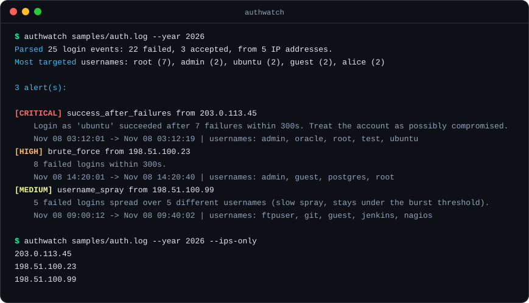

<p align="center">
  
</p>

<p align="center">
  <a href="#quick-start">Quick start</a> &nbsp;·&nbsp;
  <a href="#usage">Usage</a> &nbsp;·&nbsp;
  <a href="#detection-rules">Detection rules</a> &nbsp;·&nbsp;
  <a href="#options">Options</a> &nbsp;·&nbsp;
  <a href="#if-you-find-an-attacker">If you find an attacker</a>
</p>

<p align="center">
  <a href="https://github.com/lasmeldas/authwatch/actions/workflows/ci.yml"></a>
  
  
  
</p>

<p align="center"><b>See who is attacking your SSH server, and whether anyone got in.</b></p>

<p align="center">
  
</p>

`authwatch` reads an OpenSSH auth log and turns thousands of noisy lines into a short list of what matters: who is brute-forcing you, who is slowly guessing usernames, and, most importantly, whether a login **succeeded** right after a burst of failures. It's a quick-triage tool for servers you own or administer.

## Features

- **Brute-force detection:** many failed logins from one IP within a sliding time window.
- **Success-after-failures alerts:** flags the most dangerous case, a successful login right after a burst of failures from the same address, as *critical*.
- **Slow username-spray detection:** catches attackers who try many usernames slowly enough to stay under the burst threshold.
- **Trusted addresses:** `--ignore-ip` skips your own IPs or whole networks (CIDR), so you don't alert on yourself.
- **Ban-list output:** `--ips-only` prints just the offending IPs, one per line.
- **Script-friendly:** `--json` output and `--fail-on-alert` for cron jobs and CI.
- **No dependencies.** Tested on Python 3.9, 3.11 and 3.13 in CI.

## Quick start

```bash
git clone https://github.com/lasmeldas/authwatch.git
cd authwatch
pip install -e .
authwatch samples/auth.log --year 2026
```

The included sample uses reserved documentation IP addresses (RFC 5737), so nothing in it is real.

## Usage

```bash
authwatch /var/log/auth.log                       # Debian/Ubuntu (may need sudo to read)
authwatch /var/log/secure                         # RHEL/Fedora
journalctl -u ssh --no-pager | authwatch -        # read from stdin
authwatch auth.log --ignore-ip 10.0.0.0/8 --ignore-ip 203.0.113.7
authwatch auth.log --json                         # machine-readable
authwatch auth.log --ips-only                     # one flagged IP per line
authwatch auth.log --fail-on-alert                # exit status 1 if anything is flagged
```

**Run it from cron and get told when something is found:**

```bash
0 * * * * authwatch /var/log/auth.log --ignore-ip 203.0.113.7 --fail-on-alert >/tmp/authwatch.txt || mail -s "SSH alert" you@example.com < /tmp/authwatch.txt
```

## Detection rules

Each IP produces at most one alert, using the most serious rule that matches.

| Severity | Rule | Triggers when |
|----------|------|---------------|
| critical | `success_after_failures` | a login succeeds after `--threshold` or more failures within `--window` seconds |
| high | `brute_force` | `--threshold` or more failures within `--window` seconds |
| medium | `username_spray` | `--spray-users` or more different usernames tried, without a burst |

## Options

| Option | Default | Meaning |
|--------|---------|---------|
| `logfile` | `-` (stdin) | path to the log file |
| `--threshold` | 5 | failures that count as a burst |
| `--window` | 300 | burst window in seconds |
| `--spray-users` | 5 | distinct usernames that count as a spray |
| `--ignore-ip` | none | trusted IP or CIDR network to skip (repeatable) |
| `--year` | current year | syslog timestamps have no year, so set this for older logs |
| `--json` | off | print JSON instead of text |
| `--ips-only` | off | print only the flagged IPs, one per line |
| `--fail-on-alert` | off | exit with status 1 if any alert is found |

## If you find an attacker

authwatch only reports; it never blocks anything. Typical next steps:

- Disable password logins and use SSH keys only, and set `PermitRootLogin no`.
- Run [fail2ban](https://github.com/fail2ban/fail2ban) to ban offenders automatically.
- Rotate the credentials of any account named in a **critical** alert, and check it for signs of compromise.
- If you feed `--ips-only` into a firewall, review the list first and always pass your own addresses with `--ignore-ip`, so you can't lock yourself out.

## Limitations

- Understands OpenSSH `sshd` messages in the classic syslog format only.
- Works per source IP, so a distributed attack from many IPs may stay under the thresholds.
- A quick triage tool, not a full intrusion detection system.

## Roadmap

- ISO-8601 timestamp support (journald `--output=short-iso`)
- GeoIP and reverse-DNS hints for flagged addresses
- A watch mode that follows a log file as it grows

## Development

```bash
pip install -e . pytest
pytest -q
```

Issues and pull requests are welcome.

## License

[MIT](LICENSE)
